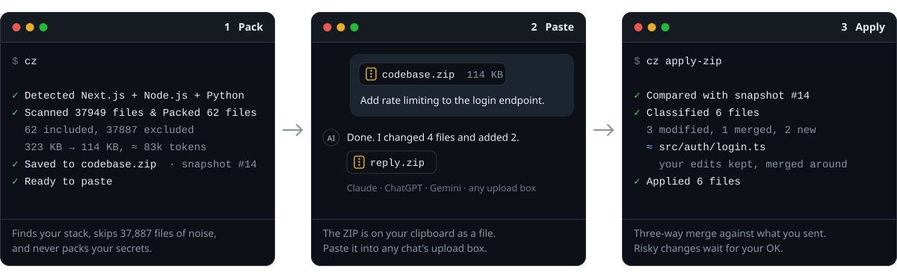
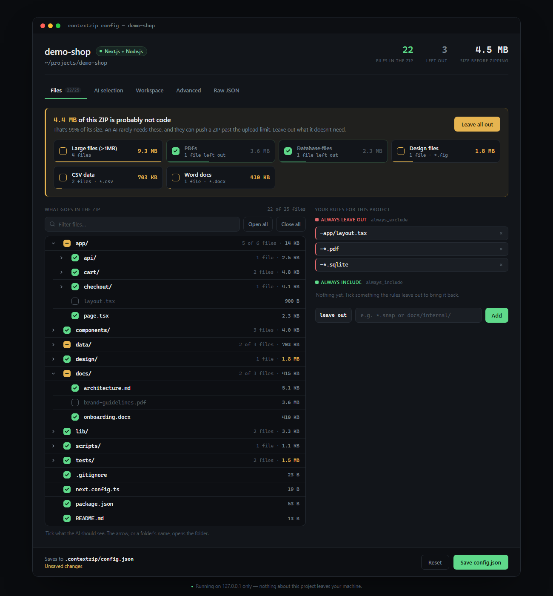

<div align="center">


# contextzip

### Send your codebase to any AI chat. Get the changes back.

One command zips the right files for Claude or ChatGPT.<br>
Another writes the AI's reply into your project, without losing your own edits.

[](https://pypi.org/project/contextzip/)
[](https://www.npmjs.com/package/@contextzip/cli)
[](https://marketplace.visualstudio.com/items?itemName=contextzip.contextzip)
[](https://github.com/akadeepesh/contextzip/actions/workflows/tests.yml)
[](https://pepy.tech/projects/contextzip)
[](https://github.com/akadeepesh/contextzip/blob/main/LICENSE)

**[Try it in your browser](https://www.contextzipcli.com)** &nbsp;·&nbsp;
[Docs](https://www.contextzipcli.com/docs/getting-started) &nbsp;·&nbsp;
[CLI reference](https://github.com/akadeepesh/contextzip/blob/main/CLI.md) &nbsp;·&nbsp;
[Changelog](https://github.com/akadeepesh/contextzip/blob/main/CHANGELOG.md)

</div>

<p align="center">
  
</p>

```bash
pip install contextzip      # or: npm i -g @contextzip/cli  ·  brew install akadeepesh/tap/contextzip
cz                          # zip the right files and put the ZIP on your clipboard
cz apply-zip                # write the AI's reply back into your project
```

<p align="center">
  Nothing to install? <a href="https://www.contextzipcli.com">Drop a folder on contextzipcli.com</a>. It's packed in your browser and never uploaded.<br>
  <a href="https://youtu.be/9FnYfyB3qd8">▶ Watch the whole loop in 72 seconds</a>
</p>

---

## Why

Every AI coding session in a web chat starts the same way: hunt down the relevant files, leave out `node_modules` by hand, zip, upload. Then the slow part: copy the AI's edits back file by file, into the right folders, and hope you didn't overwrite something you changed in the meantime.

contextzip does both directions.

| | |
|---|---|
| **Knows your stack** | 62 languages and frameworks, from Next.js, Django and Spring Boot to .NET, Laravel, Flutter and C++. Each brings its own rules for what to leave out, and monorepos get all that apply. |
| **Leaves out the noise** | Dependencies, build output, caches, lockfiles, binaries and everything in your `.gitignore`. On this project's website repo that is 37,887 of 37,949 files. |
| **Never sends secrets** | `.env`, private keys, cloud credentials and Terraform state stay out. Include a `.env` on purpose and its keys are kept while every value becomes `[REDACTED]`. |
| **Pastes as a file** | The ZIP goes on your clipboard as a real file, folders intact. Ctrl+V in Claude, ChatGPT or Gemini attaches it. |
| **Brings the changes back** | `cz apply-zip` finds where each returned file belongs and three-way merges it against a snapshot of what you sent. Conflicts and cut-off files wait for your decision. |
| **Stays on your machine** | No telemetry. Packaging and applying make no network requests. |

## How it compares

Other tools turn a repository into one text file for an AI to read. contextzip sends the real files, and its main job is the way back.

| | contextzip | [repomix](https://github.com/yamadashy/repomix) | [gitingest](https://github.com/coderamp-labs/gitingest) | [code2prompt](https://github.com/mufeedvh/code2prompt) |
|---|---|---|---|---|
| Output | ZIP of the real files | One text file (XML, Markdown, JSON) | One text digest | One templated prompt |
| Applies the AI's changes back | **Yes**, three-way merge | No | No | No |
| Reply to a repo as a pull request | **Yes** | No | No | No |
| What it leaves out | Rules for 62 stacks, plus `.gitignore` | One default list, plus `.gitignore` | `.gitignore` and your patterns | `.gitignore` and your globs |
| Secrets | Excluded, or redacted if included | Suspicious files are skipped | Not covered in its docs | Not covered in its docs |
| Remote repos without cloning | GitHub, GitLab, Bitbucket | GitHub | GitHub | Not covered in its docs |
| Runs in | Terminal, browser, VS Code, MCP | Terminal, browser, MCP | Terminal, browser | Terminal, MCP |

If you only want an AI to *read* a repository, any of them works, and a single text file pastes into more places than a ZIP does. repomix also counts tokens exactly and can compress code down to its signatures, which contextzip doesn't do yet. If you want the AI's edits back in your code, that is what contextzip is for.

<sub>The other columns come from each project's own documentation as of October 2026. <a href="https://github.com/akadeepesh/contextzip/issues/new/choose">Corrections are welcome.</a></sub>

## Installation

```bash
pip install contextzip                    # Python 3.9+   (also: pipx install, uv tool install)
npm install -g @contextzip/cli            # no Python needed, any OS
brew install akadeepesh/tap/contextzip    # macOS, Linux
```

Every method installs two commands that do the same thing: `contextzip` and the shorter `cz`. To update later, run `contextzip update`.

<details>
<summary><b>More ways to install</b>: Scoop, direct download, VS Code, MCP, or try it without installing</summary>

<br>

```bash
# Windows (Scoop)
scoop bucket add contextzip https://github.com/akadeepesh/scoop-bucket
scoop install contextzip

# Try it once, nothing stays installed
npx @contextzip/cli
uvx contextzip
pipx run contextzip
```

- **Direct download:** grab an archive from the [latest release](https://github.com/akadeepesh/contextzip/releases/latest), unpack it, and put the `contextzip` folder on your PATH. Builds exist for Windows x64, macOS (Apple Silicon and Intel) and Linux x64/arm64 (glibc 2.35 or newer).
- **VS Code:** install [contextzip from the Marketplace](https://marketplace.visualstudio.com/items?itemName=contextzip.contextzip), or run `code --install-extension contextzip.contextzip`. It bundles the CLI.
- **AI agents:** `pip install "contextzip[mcp]"` and register `contextzip mcp` as an MCP server (Python 3.10+).
- **No install:** [contextzipcli.com](https://www.contextzipcli.com).

</details>

<details>
<summary><b>"<code>cz</code> is not recognized" / "command not found"</b></summary>

<br>

pip installed contextzip, but put the `cz` command in a folder your terminal doesn't search. This is common with Python from the Microsoft Store on Windows, and with `pip install --user` on macOS and Linux. Python itself always works, so let contextzip fix PATH for you:

```bash
python -m contextzip setup-path     # macOS / Linux: python3 -m contextzip setup-path
```

On Windows this adds the folder to your user PATH (no admin needed). On macOS and Linux it adds one line to your shell's startup file. Open a new terminal and `cz` works. Until then, `python -m contextzip` does everything `cz` does. If you installed with pipx, run `pipx ensurepath`; with uv, `uv tool update-shell`.

</details>

## Quick start

```bash
cd ~/projects/my-app
cz
```

No flags needed. contextzip detects your framework, leaves out the noise, writes `codebase.zip` and copies it to your clipboard. Paste it into your AI tool, ask for what you want, and when it sends files back:

```bash
cz apply-zip
```

The commands you'll use most:

```bash
cz --dry-run --verbose              # preview every included and excluded file, write nothing
cz --git-changes                    # only what you've changed
cz include src/ app/                # only these folders
cz exclude tests/ '*.snap'          # everything except these
cz include src/ .env                # .env too, with its values redacted
cz --prompt "fix the login redirect bug"    # let AI pick the relevant files
cz github.com/user/repo             # a GitHub, GitLab or Bitbucket repo, without cloning it
cz --here                           # only the folder you're in (monorepos)
cz stacks                           # the languages and frameworks it recognises
```

## Applying AI changes back

```bash
cz apply-zip              # picks up a ZIP from .contextzip/inbox/
cz apply-zip fix.zip      # or point at one directly
cz apply-zip --dry-run    # preview without writing anything
```

AI tools return ZIPs in every shape: wrapped in an extra folder, relative to a subfolder, flattened, with Windows separators. `apply-zip` matches each file to its real place in your project anyway.

Every ZIP contextzip makes is kept as a local **snapshot** (never uploaded). When a reply comes back, three versions of each file are compared: what you sent, what's on disk now, and what came back.

| Status | Meaning | Default |
|---|---|---|
| **New** / **Modified** | New file, or only the AI changed it | Written |
| **Merged** | You both changed it, in different places | Written (three-way merge) |
| **Unchanged** | Already matches, including changes you already applied | Skipped |
| **Conflict** | You both changed the same or neighbouring lines | Needs your call |
| **Partial** | The AI returned a cut-down file (`// ... rest unchanged`) | Needs your call |
| **Moved** | The AI moved or renamed it | Written at the new path; the old file is kept unless you say otherwise |
| **Drifted** / **Deleted** / **Untracked** / **Ambiguous** / **Delete requested** | Can't be applied safely without you | Needs your call |

When something needs a decision you choose: apply the safe changes now, review side by side in your browser (`--review`), resolve in VS Code's merge editor (`--editor`), or apply everything. Line endings never count as a change, redacted secrets are never overwritten with placeholders, and files are only removed with your explicit OK.

Each ZIP also carries a short `CONTEXTZIP.md` telling the AI how to reply so the answer applies cleanly: complete files, same paths, moves and deletions listed.

## Secrets

Secret files are excluded from every project, whatever its stack: `.env` and `.env.*`, `*.pem`, `*.key`, keystores, SSH private keys, `.npmrc`, `.netrc`, cloud credential files, kubeconfigs and Terraform state.

When the AI needs to see which settings exist, include the file on purpose. Keys and comments are kept; values are not:

```bash
# .env on disk                          # .env in the ZIP
DATABASE_URL=postgres://u:pw@db/app     DATABASE_URL=[REDACTED]
export API_KEY="sk-live-…"  # prod      export API_KEY="[REDACTED]"  # prod
```

Spring Boot's `application.properties` and `application.yml` are always redacted the same way, because they are config the AI needs and routinely hold live passwords:

```bash
# application.properties on disk                       # in the ZIP
spring.datasource.url=jdbc:postgresql://app:pw@db/app   spring.datasource.url=jdbc:postgresql://app:[REDACTED]@db/app
spring.datasource.password=hunter2                      spring.datasource.password=[REDACTED]
jwt.secret=${JWT_SECRET:dev-secret}                     jwt.secret=${JWT_SECRET:[REDACTED]}
```

When the file comes back, `apply-zip` keeps your real values. Set `limits.redact_secrets: true` to also mask API keys, tokens and private-key blocks hardcoded in ordinary files. Before sharing a sensitive project, `cz --dry-run --verbose` shows exactly what will go in.

## Stacks

contextzip recognises a stack from marker files (`package.json`, `pyproject.toml`, `pom.xml`, `*.csproj`, `composer.json`, `pubspec.yaml`, `Cargo.toml`, `go.mod`) and the dependencies they list. It looks a couple of levels deep and reads workspace files, so a monorepo with a React frontend and a Spring Boot backend gets both rule sets. A folder of scripts with no project file is recognised by its file types.

| Ecosystem | Frameworks recognised | Examples of what's excluded |
|---|---|---|
| **JavaScript / TypeScript** | Next.js, Nuxt, SvelteKit, Astro, Remix, Gatsby, Angular, Vue, Svelte, Vite, NestJS, Expo, React Native, Electron, Tauri, Bun, Deno | `node_modules/`, `.next/`, `.nuxt/`, `.svelte-kit/`, `dist/`, `coverage/`, lockfiles, `*.min.js` |
| **Python** | Django, FastAPI, Flask, Jupyter | `__pycache__/`, `.venv/`, `*.pyc`, `.pytest_cache/`, `*.egg-info/`, model weights |
| **Java / Kotlin / Scala / Clojure** | Spring Boot, Android | `target/`, `build/`, `.gradle/`, `*.class`, `*.jar`, build wrappers, IDE files |
| **C# / .NET** | Unity | `bin/`, `obj/`, `.vs/`, `*.nupkg`; for Unity: `Library/`, `*.meta`, scenes and prefabs |
| **PHP** | Laravel, Symfony, WordPress | `vendor/`, `composer.lock`, `storage/framework/`, `var/`, WordPress core and `wp-config.php` |
| **Swift / Dart** | Xcode, SwiftPM, CocoaPods, Flutter | `.build/`, `DerivedData/`, `Pods/`, `*.pbxproj`, `.dart_tool/`, `*.g.dart` |
| **C / C++** | CMake, Meson, Autotools, MSBuild, Bazel | `build/`, `cmake-build-*/`, `CMakeCache.txt`, `*.o`, `*.obj`, `bazel-*/` |
| **Rust, Go, Zig, Nim** | | `target/`, `Cargo.lock`, `vendor/`, `go.sum`, `zig-out/` |
| **Ruby** | Rails, Jekyll | `vendor/bundle/`, `tmp/`, `log/`, `storage/`, `_site/` |
| **Elixir / Erlang** | Phoenix | `_build/`, `deps/`, `mix.lock`, `*.beam` |
| **Haskell, OCaml, R, Julia, Lua, Perl** | | `dist-newstyle/`, `_build/`, `renv/library/`, `Manifest.toml` |
| **Other** | Terraform, Foundry, Hardhat, Godot, Unreal Engine, Hugo | `*.tfvars`, `.terraform.lock.hcl`, `out/`, `artifacts/`, `.godot/`, `Intermediate/` |

`cz stacks` lists all 62, and `cz stacks laravel` shows everything one leaves out. Missing yours? [Request it](https://www.contextzipcli.com/request-language), or [add it](https://github.com/akadeepesh/contextzip/blob/main/CONTRIBUTING.md#adding-a-new-language-or-framework): one table entry and one test case.

## More ways to use it

### In your browser

[contextzipcli.com](https://www.contextzipcli.com) runs the same code as the CLI, in the page.

- **Drop a folder** and it's packaged locally. Your files never leave your machine.
- **Paste a repo link** to package a public repository. Shortcut: put `contextzipcli.com/` in front of a repo URL, as in `contextzipcli.com/github.com/user/repo`.
- **Apply the AI's reply** to your folder (Chrome and Edge): pick the folder and the ZIP, review the plan, and the safe changes are written for you.

### A repository, without cloning it

```bash
cz github.com/pallets/click
cz https://github.com/pallets/click/tree/main/src     # one branch, one folder
cz gh:you/private-repo --ref dev
cz gitlab.com/group/project                           # or gl:group/project
cz bitbucket.org/team/repo                            # or bb:team/repo
```

contextzip downloads one commit through the host's API and packages it like any other project. Private repos use `GITHUB_TOKEN` (or your `gh` login), `GITLAB_TOKEN` or `BITBUCKET_TOKEN`; a token is only ever sent to its own host. For a GitHub repo, `cz apply-zip reply.zip --pr` commits the AI's changes and **opens a pull request**, forking first if you can't push.

### VS Code extension

[contextzip for VS Code](https://marketplace.visualstudio.com/items?itemName=contextzip.contextzip) bundles the CLI, so it works without Python. Package the project, a selection, your git changes or a GitHub repo from the Explorer's right-click menu. When an AI's ZIP lands in your Downloads, the extension offers to apply it: every file's status shows in the **AI Changes** view, safe changes apply in one step, and conflicts open in the three-way merge editor.

### MCP server for AI agents

```bash
pip install "contextzip[mcp]"      # Python 3.10+
```

```json
{"mcpServers": {"contextzip": {"command": "contextzip", "args": ["mcp"]}}}
```

An agent can then package a project or a repository, preview and apply a reply, list snapshots and open a pull request. See [CLI.md](https://github.com/akadeepesh/contextzip/blob/main/CLI.md#contextzip-mcp) for every tool.

### Let AI pick the files

```bash
cz --prompt "add rate limiting to the login endpoint"
```

Describe the task and [Gemini](https://ai.google.dev/) picks only the files that matter; the ZIP also gets a `prompt.txt` describing the task. It needs a free Gemini API key, which contextzip walks you through the first time. Only file **paths and sizes** plus your prompt are sent, never file contents. If Gemini is rate-limited, a local keyword-based selector takes over.

### Choose files visually

```bash
cz config --ui
```

<p align="center">
  
</p>

A local browser tab where you tick what goes in the ZIP. It shows how big each folder is, points out what is probably not code, and saves your choices to `.contextzip/config.json`. The server binds to `127.0.0.1` only, needs a one-time session token and shuts itself down when you're done.

### Package the moment something breaks

```bash
cz watch -- npm run dev
```

contextzip runs your command and watches its output. When a stack trace appears (Python, Node.js and Java/Kotlin errors are recognised), press `D` to get a ZIP with the error, a ready-made prompt and the source files named in the trace.

## Command reference

| Command | What it does |
|---|---|
| `cz` | Detect the stack, leave out the noise and package the project |
| `cz include PATH…` | Package **only** these paths |
| `cz exclude PATTERN…` | Package everything **except** these patterns |
| `cz --git-changes` | Package only modified, staged and untracked files |
| `cz --prompt "task"` | Let Gemini pick only the files relevant to a task |
| `cz github.com/user/repo` | Package a GitHub, GitLab or Bitbucket repository without cloning it |
| `cz apply-zip [ZIP]` | Write an AI-returned ZIP back into your project, safely |
| `cz apply-zip ZIP --pr` | Send an AI's reply to a GitHub repo back as a pull request |
| `cz snapshots` | List what you've sent, so a reply can be merged against it |
| `cz stacks` | List the languages and frameworks contextzip recognises |
| `cz watch -- COMMAND` | Run a command and package debug context when an error appears |
| `cz config …` | Gemini key, workspace location and the visual config UI |
| `cz mcp` | Run the MCP server for AI agents |
| `cz update` | Update to the latest release |
| `cz setup-path` | Put `cz` on your PATH when pip didn't |

<details>
<summary><b>Run flags</b> (work on <code>cz</code>, <code>include</code> and <code>exclude</code>)</summary>

<br>

| Flag | Short | Description |
|---|---|---|
| `--include PATH` | `-i` | Only include files under these paths. Naming an excluded path (like `.env`) brings it back. Repeatable. |
| `--exclude PATTERN` | `-e` | Extra exclusion patterns (gitignore syntax). Repeatable. |
| `--prompt TEXT` | `-p` | Let Gemini select files relevant to this task. |
| `--git-changes` | | Only include files git reports as changed. |
| `--dry-run` | `-n` | Show what would be included without creating the ZIP. |
| `--output FILE` | `-o` | Write the ZIP to this exact path. |
| `--no-clipboard` | | Don't copy the ZIP to the clipboard. |
| `--no-gitignore` | | Ignore `.gitignore` and use only the built-in rules. |
| `--verbose` | `-v` | List every included and excluded file. |
| `--here` | | Only package the folder you're in. |
| `--from REPO` | | Package a remote repository (or just put the repo first: `cz github.com/user/repo`). |
| `--ref REF` | | Branch, tag or commit for `--from`. |
| `--json` | | Print one JSON object instead of terminal output, for editors and scripts. |

</details>

Every command supports `-h`. For every flag of every subcommand, see **[CLI.md](https://github.com/akadeepesh/contextzip/blob/main/CLI.md)** or the [online reference](https://www.contextzipcli.com/docs/cli).

## Configuration

Both config files are optional. Per-project settings live in `.contextzip/config.json`; edit it by hand or with `cz config --ui`.

```jsonc
{
  "always_include": ["docs/architecture.md"],  // force-include, even if a rule or .gitignore excludes it
  "always_exclude": ["*.snap", "fixtures/"],   // a standing --exclude on every run
  "workspace_location": "git-root",            // "git-root" | "cwd" | "/some/path"
  "ai": {
    "enabled": true,
    "max_files": 10,                           // cap on files the AI may select
    "prompt_template": "We use pytest, not unittest."  // prepended to every prompt.txt
  },
  "limits": {
    "max_file_size_mb": 1,                     // threshold for "large file" warnings
    "redact_secrets": false                    // also mask secret-looking values in ordinary files
  },
  "snapshots": { "keep": 10, "max_age_days": 14 },  // history apply-zip merges against
  "zip_guide": true                            // add CONTEXTZIP.md to every ZIP
}
```

`.contextzip/` is git-ignored by default. To share these settings with your team, commit the file explicitly: `git add -f .contextzip/config.json`. Your Gemini API key and personal defaults live outside the project (`~/.config/contextzip/` or `%APPDATA%\contextzip\`), so they're never committed. The full guide is at [contextzipcli.com/docs/configuration](https://www.contextzipcli.com/docs/configuration).

### Which rule wins

When they disagree, the more specific source wins:

1. **The command you typed.** `exclude` / `--exclude` always leaves a file out. `include` / `--include` scopes the run, and a file or folder you name is included even if it's a `.env`, is in `.gitignore`, or is excluded by the config.
2. **The project config:** `always_include`, then `always_exclude`.
3. **Your `.gitignore`.** A `!pattern` there brings back a file the built-in rules would drop, such as `!.env.example`.
4. **The built-in rules** for the detected stack.

Including a folder is a scope, not an override: `cz include src/` still leaves out `src/.env` and whatever `.gitignore` ignores inside `src/`. Name the file itself to bring it in. A secret file that ends up in the ZIP, by any of these routes, has its values redacted.

<details>
<summary><b>What is always excluded</b></summary>

<br>

These apply to **every** project, whatever its stack, and in `--git-changes` mode too:

- **Secrets & credentials:** `.env`, `.env.*`, `*.pem`, `*.key`, `*.p12`, `*.pfx`, `*.jks`, `*.keystore`, `*.ppk`, SSH private keys (`id_rsa`, `id_ed25519`, …), `.npmrc`, `.netrc`, `.pypirc`, `.pgpass`, Docker auth config, `.aws/credentials`, service-account and `*credentials*.json` files, kubeconfigs
- **Infrastructure state:** `*.tfstate`, `.terraform/`
- **Version control & editors:** `.git/`, `.svn/`, `.hg/`, `.vscode/`, `.idea/`, swap files, `.DS_Store`
- **Logs, caches & temp files:** `*.log`, `logs/`, `.cache/`, `tmp/`, `*.tmp`, `*.bak`
- **Binaries & media:** executables, shared libraries, images, video, audio, fonts and archives
- **Project boilerplate:** `CHANGELOG`, `LICENSE`, `CONTRIBUTING`, `SECURITY.md`, `CODE_OF_CONDUCT.md`, GitHub issue/PR templates

To bring one back, name it with `cz include .env`, list it under `always_include`, tick it in `cz config --ui`, or un-ignore it in `.gitignore` (`!.env.example`).

</details>

<details>
<summary><b>Where files go</b></summary>

<br>

contextzip keeps everything in a `.contextzip/` folder at your git root (change this with `cz config --set-workspace`):

```text
.contextzip/
├── output/
│   ├── codebase/      codebase.zip + manifest + report   (cz)
│   ├── git-changes/   changes.zip + manifest + report    (--git-changes)
│   ├── prompt/        vibe.zip + manifest + report       (--prompt)
│   └── watch/         debug-context.zip                  (cz watch)
├── snapshots/         numbered copies of what you sent   (cz snapshots)
├── inbox/             drop AI-returned ZIPs here for apply-zip
└── config.json        project config (optional)
```

Old outputs are cleaned up automatically: `output/` keeps the latest ZIP per mode, and `snapshots/` keeps the newest 10 or anything under 14 days old, never one a reply in the inbox is waiting on.

</details>

## Python API

contextzip is also a library. The functions behave like the CLI but return plain Python objects and raise exceptions instead of printing.

```python
from contextzip import get_files, get_git_changes, create_zip, apply_zip, fetch_remote

collection = get_files(include=["src/"], exclude=["*.log"])   # filtered like the CLI
pkg = create_zip(get_git_changes(), output="/tmp/changes.zip")
print(f"Packed {pkg.file_count} files → {pkg.zip_path}")

repo = fetch_remote("github.com/pallets/click")               # a repository, without cloning it
pkg = create_zip(get_files(repo.project_dir), output=repo.zip_path)
```

All exceptions inherit from `ContextzipError`. Full signatures are in the [API reference](https://www.contextzipcli.com/docs/cli#python-api).

## Privacy & security

- **Local by default.** Packaging, `apply-zip`, `watch` and the config UI never make network requests.
- **Network use is opt-in and limited to three features:** `--prompt` sends file paths, sizes and your prompt to the Gemini API, never file contents. Packaging a remote repo downloads it from that host, and `apply-zip --pr` opens a pull request on GitHub. `cz update` asks PyPI for the latest version number.
- **No telemetry.** Nothing is collected or phoned home.
- **Secrets are excluded or redacted.** See [Secrets](#secrets).

Found a vulnerability? Please follow [SECURITY.md](https://github.com/akadeepesh/contextzip/blob/main/SECURITY.md) and report it privately.

## Platform support

| | Windows | macOS | Linux |
|---|---|---|---|
| Packaging, `apply-zip`, config | ✅ | ✅ | ✅ |
| ZIP copied to clipboard as a file | ✅ native | ✅ via Finder | ✅ X11 (works under XWayland), `wl-copy` or `xclip` |
| `cz watch` | ✅ | ✅ | ✅ |
| Standalone build (no Python) | ✅ x64 | ✅ Apple Silicon and Intel | ✅ x64 and arm64, glibc 2.35+ |

If the clipboard can't be used, contextzip opens the output folder with the ZIP selected and tells you why.

## Contributing

Contributions are welcome, especially **new languages and frameworks**: one entry in `contextzip/stacks.py`, a `PATTERNS` list and one test case. [CONTRIBUTING.md](https://github.com/akadeepesh/contextzip/blob/main/CONTRIBUTING.md) walks through it. Not up for writing code? [Request a feature](https://www.contextzipcli.com/request-feature) or [request your language](https://www.contextzipcli.com/request-language); both become GitHub issues ranked by 👍.

```bash
git clone https://github.com/akadeepesh/contextzip
cd contextzip
python -m venv .venv && source .venv/bin/activate   # Windows: .venv\Scripts\activate
pip install -e . pytest
python -m pytest
```

If contextzip saves you time, a ⭐ helps other people find it.

## License

[MIT](https://github.com/akadeepesh/contextzip/blob/main/LICENSE) © Deepesh

<p align="center"><sub>
  Built by <a href="https://akadeepesh.com?ref=github">Deepesh Kumar</a>
</sub></p>
